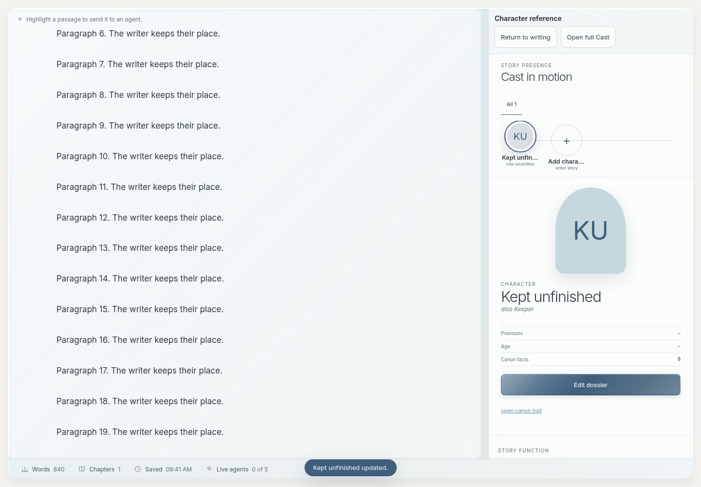

# ADR-002: Keep writing continuous while consulting characters

Status: Accepted by Dennis, 2026-10-17. Implemented and verified. Subjective writing-flow acceptance remains with Dennis.

## Context and decision

Characters currently maximizes Cast, interrupting manuscript visibility. First experiment covers writing → consult/edit character → resume writing. Preserve appearance, existing forms and recovery. Use temporary presentation state over mounted editors: manuscript beside 420px character column when content width is at least 1,000px, otherwise modal reference sheet.

Options considered: animations alone (low cost, does not solve context switch); temporary paired view (medium cost, selected); whole-workspace redesign (high cost, insufficient user evidence). Existing stable portal hosts and recovery-aware character forms support the selected approach without server/schema changes.

## Contract

- Drafting Characters uses last visible manuscript, or the sole visible manuscript; ambiguous/absent manuscript retains full Cast. Planning, Review and explicit Workbench retain behavior.
- Focus Story Cards character editing enters consultation directly. Repeated opens reuse hosts and forms.
- Return restores previous arrangement and latest manuscript bookmark. Exact selection/direction and unchanged-geometry scroll; relative scroll after reflow.
- Return parks unfinished character form. Save uses existing explicit save/recovery checks; Cancel remains explicit discard. Failed save stays editable.
- Escape dismisses nested layer first, then character editor to detail, then consultation to prose. Respect IME/browser fullscreen.
- Open full Cast exits consultation and promotes same Cast host. Character navigation elsewhere exits consultation first.
- No new persistent settings or project schema. Runtime companion panes are excluded from Saved Desks. Invalidate on project/session/workspace change or removed manuscript.
- Preserve mounted manuscript and character-form identity across return, resize and presentation changes. No duplicate draft owners.
- Reduced-motion disables optional 140ms companion transition; no animated manuscript dimensions/scroll. Touch targets at least 44px.

## Verification and rollout

Use disposable projects/browser storage. Verify selection/backward ranges, scroll, undo, latest-position updates, original arrangement and unsent questions; save/cancel/park/reopen/failures; 320/390px sheet, resize, keyboard and focus. Regress Focus Cards, Workbench, character recovery, workspace windows, mobile writing and Saved Desks. Build/typecheck, inspect screenshots, scope commit/push. User comparison determines subjective success; do not infer it from automated tests.

## Checkpoints and handoff

1. Record baseline and ADR.
2. Implement presentation state and desktop hosts.
3. Integrate live character forms, mobile, keyboard, recovery and motion.
4. Verify and release scoped change.
5. Collect real writing observations before extending to other tools.

Begin handoff preparation at 20% remaining in either usage window, stop feature work by 15%. No reset credits without authorization. Handoff includes Git/files/contracts/tests/artifacts/issues/next action/usage timestamp. Unrelated notes stay untouched. Broader navigation, toolbar, drag, Studio and other reference-tool changes are deferred.

## Verification evidence — 2026-10-17

Final affected browser run: **42 passed (2.6 minutes)**. Frontend TypeScript and production build passed; Vite retains its bundle-size warning. Tests used disposable projects and isolated browser storage, without modifying the live KB project. No server endpoints, saved-project schemas or Studio files changed.

Coverage includes backward selection, exact unchanged-geometry scroll, user scroll after reflow, latest manuscript position, DOM/form identity, undo, unsent questions, parked drafts, explicit Save/Cancel, load/save failures, pending image upload, unavailable recovery storage, late save after project switch, repeated activation, removed manuscript, workspace switch, floating/minimized arrangement, ambiguous manuscript fallback, underlying Saved Desk capture, reduced motion, 320/390px layout, nested dialogs, IME Escape and browser fullscreen. Existing Focus Cards, Connections, recovery, Workbench, windows, mobile writing and Saved Desks suites passed.

Earlier test failures exposed presentation and fixture issues, which were corrected without weakening preservation assertions. One existing focus-toggle selection check failed intermittently in an earlier run, then passed in the final run without changes to that test or its assertions. Ten isolated baseline repetitions passed, but blocked font loading limits that comparison; no baseline attribution is claimed. Revisit if caret displacement recurs.

Desktop and mobile screenshots contain generated fixture content:

[320px reference sheet](../images/character-consultation-320.png) · [390px reference sheet](../images/character-consultation-390.png)

## User comparison still required

Write a paragraph, select a passage, open Characters, revise a detail, then use Return to writing before saving. Confirm intended writing position and reopen the same unfinished form. Compare interruption with the previous full-Cast flow; record the step that still feels rigid. Automated checks establish behavior, not subjective fluidity. Do not extend this pattern to other tools until that evidence is available.
